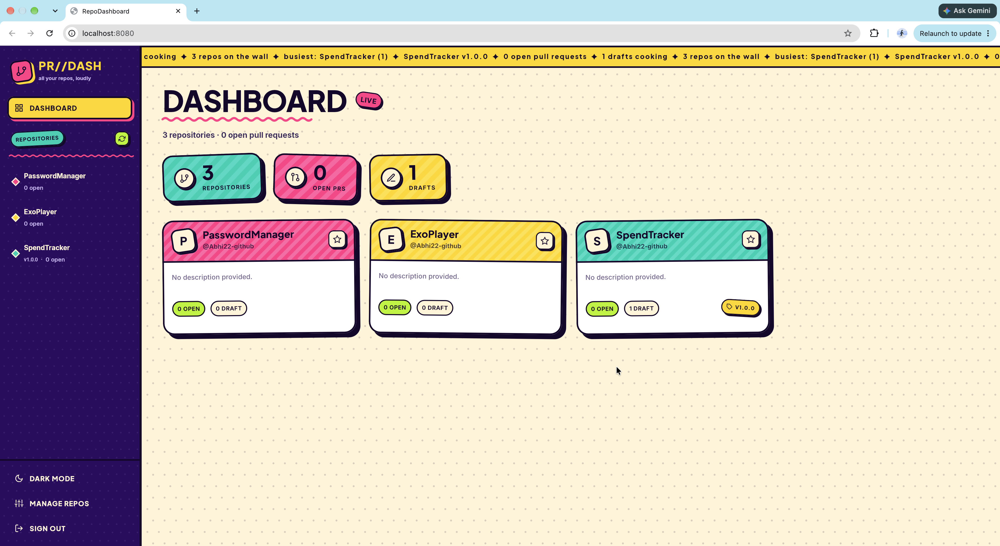
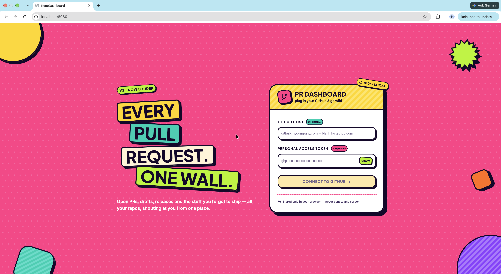
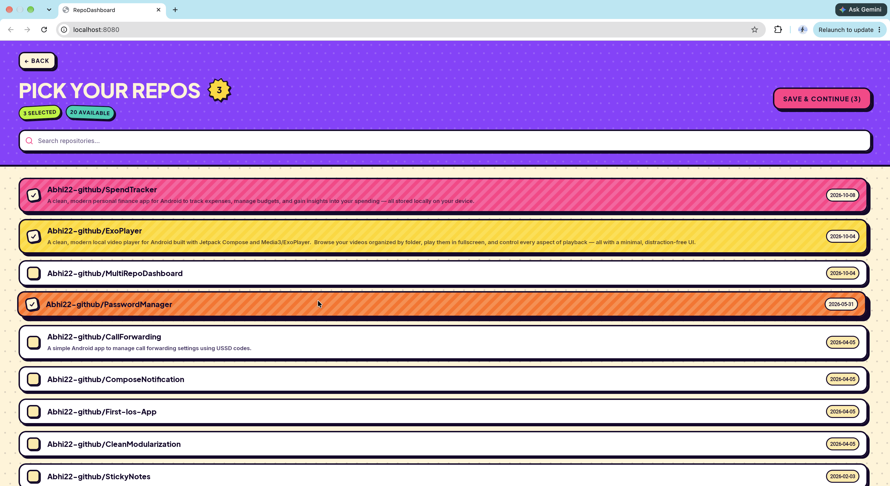
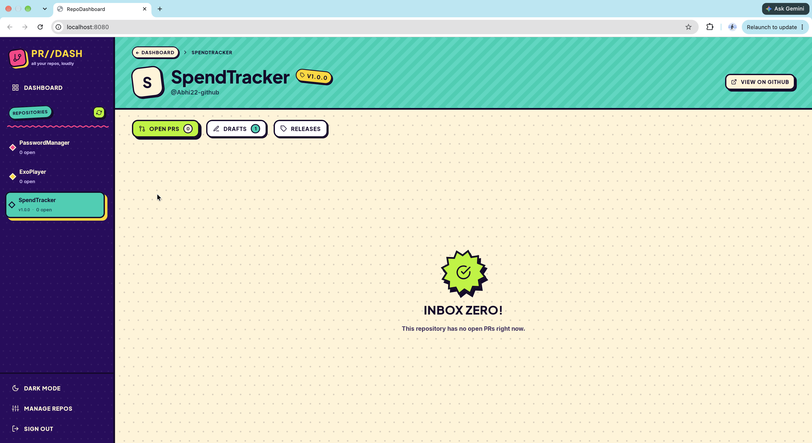

# RepoDashboard

**Every pull request. One wall.**

RepoDashboard is a GitHub dashboard that puts open PRs, drafts and releases from all the repositories you care about on a single screen. Connect with a personal access token, choose your repos, and see what's waiting for review and what's ready to ship.

It's built with **Kotlin Multiplatform + Compose Multiplatform**, so the same UI code runs as a **web app (Kotlin/Wasm)** and an **Android app**.



---

## Features

- **Dashboard overview**: totals for repositories, open PRs and drafts, plus a card for each repo showing its open/draft counts and latest release tag.
- **Live ticker**: a scrolling strip with quick stats, such as the busiest repo, latest versions and drafts in progress.
- **Repo picker**: search across every repo you can access (personal, org and collaborator) and choose which ones go on the dashboard.
- **Per-repo detail**: tabs for **Open PRs**, **Drafts** and **Releases**, with a direct link to the repo on GitHub.
- **Pinning**: star repos to keep them at the top.
- **GitHub Enterprise support**: works with github.com, GitHub Enterprise Server (`github.mycompany.com`) and Enterprise Cloud with data residency (`mycompany.ghe.com`).
- **Dark mode**
- **100% local**: your token and settings are kept in browser `localStorage` (or app storage on Android) and sent only to the GitHub API. There is no backend.

## Screenshots

| Connect | Pick your repos |
|---|---|
|  |  |

| Dashboard | Repo detail |
|---|---|
|  |  |

## Getting started

### 1. Create a GitHub token

Create a [personal access token](https://github.com/settings/tokens) with these permissions:

- **Classic token**: the `repo` scope (add `read:org` if you want org repositories).
- **Fine-grained token**: read-only access to *Pull requests*, *Contents* and *Metadata* for the repos you want to track.

### 2. Run the web app

You need JDK 21. The Gradle wrapper downloads everything else.

```bash
# Wasm target (fast, modern browsers)
./gradlew :webApp:wasmJsBrowserDevelopmentRun

# JS target (slower, supports older browsers)
./gradlew :webApp:jsBrowserDevelopmentRun
```

Or use the helper script, which compiles, starts the dev server on `http://localhost:8080` and opens Chrome:

```bash
./run-web.sh
```

### 3. Run the Android app

```bash
./gradlew :androidApp:assembleDebug
```

You can also open the project in Android Studio and run the `androidApp` configuration.

### 4. Connect

Paste your token, add your Enterprise host if you have one (leave it blank for github.com), and click **Connect to GitHub**. Then choose your repos and click **Save & Continue**.

## Deploying to Vercel

The repo is set up to deploy on Vercel as a static site:

- `vercel.json` runs `scripts/vercel-build.sh`. Vercel's build image has no JDK, so the script installs JDK 21 and then runs `./gradlew :webApp:wasmJsBrowserDistribution`.
- The site is served from `webApp/build/dist/wasmJs/productionExecutable`, with the correct `application/wasm` content type and long-lived caching for `.wasm` files.

Import the repo into Vercel and it deploys with no extra configuration.

## Project structure

```
shared/                 Shared Compose Multiplatform code
  src/commonMain/
    github/             GitHubClient: Ktor-based REST client (repos, PRs, releases)
    models/             Serializable data models
    storage/            LocalStorageManager (expect/actual per platform)
    ui/screens/         TokenInput, RepoSelection, Dashboard, RepoDetail
    ui/theme/           Theme, colors and the "maximal" design components
  src/androidMain/      Android-specific storage and platform code
  src/wasmJsMain/       Wasm storage (browser localStorage)
  src/jsMain/           JS storage (browser localStorage)
webApp/                 Web entry point, index.html and styles
androidApp/             Android entry point (MainActivity)
scripts/                Build scripts (Vercel)
```

## Tech stack

| | |
|---|---|
| Language | Kotlin 2.4 |
| UI | Compose Multiplatform 1.12, Material 3 |
| Networking | Ktor 3 |
| Serialization | kotlinx.serialization |
| Targets | Web (Wasm + JS), Android |
| Hosting | Vercel |

## Privacy

Your access token stays on your device. The app talks only to the GitHub API host you configure, and you can clear the stored token at any time with **Sign out**.
